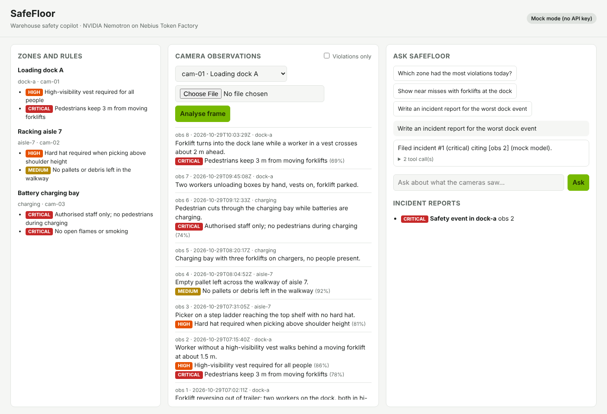

# SafeFloor

A warehouse safety copilot built on NVIDIA Nemotron models served by Nebius Token Factory.
Entry for the **Nebius x NVIDIA Global AI Hackathon 2026**, Physical AI track.



## What it does

Warehouse cameras record many hours of footage, and safety teams only look at it after something
goes wrong. SafeFloor turns camera frames and video clips into a searchable log of timed safety
events, raises alerts on critical ones, and gives supervisors an agent they can ask in plain language:

- "Which zone had the most violations today?"
- "Show near misses with forklifts at the dock."
- "Write an incident report for the worst dock event."

The agent answers from the recorded observations only. Every claim cites observation ids, a verifier
checks those citations against what the tools actually returned, and each id opens the evidence frame.

## How it works

```
video clip ──► sampled frames ──► Nemotron vision model ──► per-frame observation
camera frame ─────────────────────► (zone rules in prompt)        │
                                                                  ▼
                              timed events (peak frame as evidence) ──► SQLite + frames on disk
                                                                  │
                      critical violation ──► alert + draft incident ──► webhook / live stream / stack light
                                                                  ▼
supervisor question ──► Nemotron agent ──tool calls──► list_zones, search_observations,
                        (Token Factory,                count_violations, lookup_regulation (Tavily, osha.gov),
                         function calling)             file_incident_report
                              └─► answer ──► citation verifier ([obs N] must have been retrieved)
```

1. **Perception** (`safefloor/perception.py`). Each frame goes to a Nemotron vision-language model with
   the safety rules of that camera's zone. A tolerant parser extracts the JSON (think blocks, code
   fences and surrounding prose are ignored), matches rule ids case-insensitively, drops unknown
   ones and clamps confidences. If the first reply has no JSON the call is repeated once; if it
   still fails the API answers 502 and stores nothing.
2. **Clips to events** (`safefloor/video.py`, `safefloor/events.py`). OpenCV samples a clip (default
   1 fps, first 60 s, long side 768 px). One vision call per sampled frame; consecutive violating
   frames that share a rule (one clean frame may be bridged) merge into an event with a time range,
   the union of rules and the peak-confidence frame as evidence. A clip without violations stores one
   "no violations in clip" observation.
3. **Store** (`safefloor/store.py`). Observations, violations, incidents and alerts live in SQLite,
   with in-place migrations for older databases. Every violation takes its severity from the zone
   rule in `data/zones.json`, not from the model. Each observation records its `source`
   (`seed`, `mock` or `nemotron`) and, when available, the evidence frame.
4. **Agent** (`safefloor/agent.py`, `safefloor/tools.py`). A Nemotron model on Token Factory runs an
   OpenAI-style function-calling loop over five tools and stops after six steps. The system prompt
   carries the current UTC time. After the final answer the **citation verifier** checks every
   `[obs N]` against the ids the tools returned in that run: one corrective retry, then anything
   still unverified is rewritten to `[obs N UNVERIFIED]`.
5. **Regulation lookup** (`safefloor/regulations.py`). `lookup_regulation` runs a Tavily search limited
   to `osha.gov` using the rule's `regulation_query`. An incident report may cite only URLs
   returned by that tool in the same run; anything else is rejected.
6. **Alerts and live feed** (`safefloor/alerts.py`). A critical violation creates an alert row and a
   *draft* incident that a supervisor confirms. If `SAFEFLOOR_WEBHOOK_URL` is set the alert JSON is
   POSTed there (3 s timeout, never blocks ingestion). `GET /api/stream` pushes observations and
   alerts to the dashboard as Server-Sent Events.
7. **Dashboard** (`static/`). Zones and rules, the live observation feed with evidence thumbnails and
   source chips, frame and clip upload, the chat with an expandable tool trace and clickable citations
   (with a "citations verified" badge), the alert strip and stack light, and the incident list.

## Nebius and NVIDIA usage

| Piece | What it uses |
|---|---|
| Inference | Nebius Token Factory, OpenAI-compatible API (`NEBIUS_BASE_URL`) |
| Agent model | NVIDIA Nemotron (`NEBIUS_AGENT_MODEL`, default `nvidia/nemotron-3-super-120b-a12b`) |
| Vision model | NVIDIA Nemotron VL (`NEBIUS_VISION_MODEL`) |
| Regulation search | Tavily (`TAVILY_API_KEY`), restricted to osha.gov |
| Hosting (optional) | The Dockerfile runs on a Nebius AI Cloud VM or any container host |

Model ids change. Run `python scripts/check_models.py` with your key and copy the exact NVIDIA ids it
prints into `.env`.

## Run it

```bash
python -m venv .venv && source .venv/bin/activate   # Windows: .venv\Scripts\activate
pip install -r requirements.txt
cp .env.example .env    # then set NEBIUS_API_KEY (and optionally TAVILY_API_KEY)
```

Load the variables and start the server:

```bash
set -a; source .env; set +a
python -m safefloor
```

Open http://127.0.0.1:8000. On Windows PowerShell, set the variables with
`$env:NEBIUS_API_KEY="..."` before `python -m safefloor`.

Without `NEBIUS_API_KEY` the app starts in **mock mode**: a scripted model stands in for Nemotron so
the UI, the agent loop and the tests run offline. The badge in the header shows which mode is on.

The app seeds one shift of sample observations (`data/sample_observations.json`, labelled `seed` in
the UI) on first start. Zones, rules and regulation queries are in `data/zones.json`; edit them to
match a real site.

| Variable | Purpose | Default |
|---|---|---|
| `NEBIUS_API_KEY` | Token Factory key; unset = mock mode | none |
| `NEBIUS_BASE_URL`, `NEBIUS_AGENT_MODEL`, `NEBIUS_VISION_MODEL` | endpoint and model ids | see `.env.example` |
| `SAFEFLOOR_TIMEOUT` | model call timeout in seconds (client also retries twice) | 60 |
| `TAVILY_API_KEY` | enables `lookup_regulation` | none |
| `SAFEFLOOR_WEBHOOK_URL` | POST critical alerts here | none |
| `SAFEFLOOR_FRAMES`, `SAFEFLOOR_DB`, `SAFEFLOOR_ZONES` | evidence frames dir, database, zones file | `data/...` |
| `SAFEFLOOR_VISION_MODE` | only `per_frame` is implemented | `per_frame` |
| `SAFEFLOOR_MOCK` | force mock mode even with a key | unset |

Analyse a clip from the command line:

```bash
python scripts/replay_clip.py clip.mp4 --camera cam-01 --server http://127.0.0.1:8000 --fps 1
```

Docker:

```bash
docker build -t safefloor .
docker run -p 8000:8000 --env-file .env safefloor
```

## Tests

```bash
python -m pytest -q
```

All tests run in mock mode or against fakes, with no network. They cover the tolerant parser and
retry/502 path, the store and its migrations, clip sampling and event merging, the citation
verifier, the Tavily tool with a fake client, the alert/webhook/confirm flow, the SSE stream (against
a real uvicorn server), the benchmark arithmetic and the HTTP API. CI runs them on every pull request.

## API

| Method | Path | Body | Returns |
|---|---|---|---|
| GET | `/api/status` | | mode and model ids |
| GET | `/api/zones` | | zones with rules |
| GET | `/api/observations?zone_id=&only_violations=` | | observations with violations, `source`, `has_frame` |
| GET | `/api/observations/{id}` | | one observation |
| GET | `/api/observations/{id}/frame` | | the evidence frame (404 if none) |
| POST | `/api/frames` | multipart `camera`, `image`, optional `ts` | the new observation (502 if the vision reply is unusable) |
| POST | `/api/clips` | multipart `camera`, `video`, optional `fps` (0.5-2), `ts` | the stored events (413 over 60 MB, 400 unreadable) |
| POST | `/api/ask` | `{"question": "...", "history": [...]}` | `{"answer", "trace", "citations"}` |
| GET | `/api/incidents` | | incident reports with `status` (`draft` or `filed`) and `regulation_refs` |
| POST | `/api/incidents/{id}/confirm` | | the incident, now `filed` (404 unknown, 409 not a draft) |
| GET | `/api/alerts` | | critical alerts with their payload |
| GET | `/api/stream` | | Server-Sent Events: `observation`, `alert`, `incident` |

## Accuracy

TODO: run `python scripts/eval.py --labels data/eval/labels.json` on the labelled frames and paste the
table from `docs/EVAL.md` here. No accuracy numbers are claimed until that run exists. How to label:
`data/eval/README.md`. The same script has an ablation (`--prompt rule-ids-only`) and a model
comparison (`--vision-model <id>`).

## Limits and next steps

- Clips are analysed one sampled frame at a time and merged in code; a single multi-image call to
  the vision model is not implemented. Tracking people and forklifts across frames, which NVIDIA VSS
  does at production scale, is the next step.
- Distances such as "3 m from a forklift" are estimated by the vision model, not measured. A depth or
  calibrated-camera stage would make those rules reliable.
- Confidence scores come from the model and are not calibrated.
- The alert loop ends at a webhook and a dashboard stack light; it does not drive physical hardware.

## License

MIT, see [LICENSE](LICENSE).
