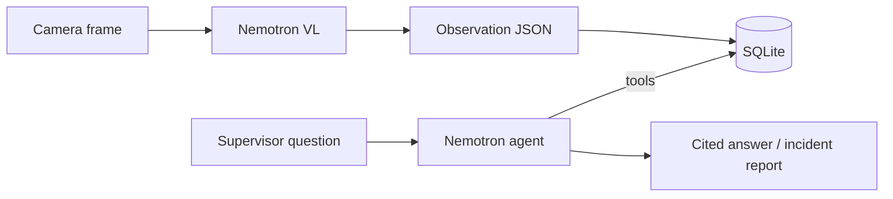

# 03 Architecture

Purpose: system overview and data flow, as implemented in the repo.

## Components
- `safefloor/perception.py`: frame + zone rules to Nemotron VL, validated JSON observation.
- `safefloor/store.py`: SQLite for observations, violations, incidents; severity from zone rules.
- `safefloor/agent.py`, `tools.py`: function-calling loop (max 6 steps) over four tools.
- `safefloor/llm.py`, `config.py`: OpenAI-compatible client, env config, mock mode.
- `safefloor/app.py`: FastAPI API; `static/`: dashboard.
- `data/zones.json`, `data/sample_observations.json`: zones/rules and seed data.

## Data flow

## Known limits
Frames analysed one at a time; distances estimated by the model; confidences uncalibrated (from README).
TODO: deployment target. Status: Unconfirmed
